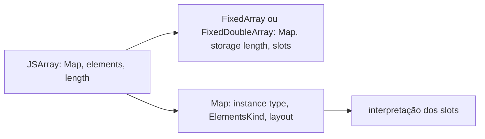

# Análise da implementação histórica

As linhas abaixo referem-se aos arquivos imutáveis em `evidence/origins/v8/` no commit `6dc88c1`; o diff está em `evidence/origins/oob.diff`.

| Estrutura / propriedade | Evidência precisa | Interpretação |
| --- | --- | --- |
| `JSArray` | `src/objects/js-array.h:19-27,98-103` | Objeto com `length` próprio; modo rápido usa backing store. O comentário documenta `length <= elements.length()`; modo lento usa tabela de hash. |
| `FixedArrayBase` | `src/objects/fixed-array.h:70-103` | Backing store tem seu próprio `length`; para arrays rápidos ele é a capacidade alocada. |
| `FixedArray` | `src/objects/fixed-array.h:114-138,178` | Slots tagged, tamanho calculado com `kTaggedSize`. |
| `FixedDoubleArray` | `src/objects/fixed-array.h:226-257` | Slots `double` não tagged; `SizeFor` usa `kDoubleSize`. |
| `get_scalar` | `src/objects/fixed-array-inl.h:318-324` | Há `DCHECK(index < this->length())`; `DCHECK` não é guarda de produção. |
| `set` | `src/objects/fixed-array-inl.h:343-352` | Calcula offset e escreve; não há verificação de índice nessa função. |
| Campo Map | `src/objects/heap-object.h:178-187` | Todo `HeapObject` começa com campo `map` tagged. |
| Campo elements | `src/objects/js-objects.h:767-774` | `JSObject` aponta para backing store. |
| Elements Kind | `src/elements-kind.h:29-45,125-138` | Separa Smi, tagged object, double e dicionário; `Map` codifica `ElementsKindBits` em `src/objects/map.h:260-272`. |

O diff instala `Array.prototype.oob` em `src/bootstrapper.cc`, registra `CPP(ArrayOob)` em `builtins-definitions.h` e acrescenta uma classificação no typer. O acesso crítico está nas linhas 22-41 do diff: após casts diretos de `receiver` e `elements`, define `length = array->length()` e usa esse valor em `elements.get_scalar(length)` ou `elements.set(length, ...)`. Como a primeira posição fora da faixa lógica é `length`, o método viola o limite lógico em toda chamada. Quando `length == elements.length()`, também alcança a primeira posição fora do backing store. Quando há capacidade excedente, o acesso pode permanecer fisicamente dentro do backing store, mas ainda toca uma posição que não pertence à faixa lógica do array. O cast para `FixedDoubleArray` não valida o Elements Kind; o cast do receiver não verifica `JSArray` antes. O teste de número de argumentos (`len > 2`) não corrige essas condições.

`FixedDoubleArray::get_scalar` possui apenas `DCHECK` de limite, e `set` não tem guarda de índice. Portanto o builtin deve validar o limite antes de chamar essas funções; não se pode inferir proteção em release a partir de `DCHECK`. Os builtins normais de arrays estão em `src/builtins/builtins-array.cc`; o builtin `ArrayOob` foi enxertado nesse arquivo pelo diff. A semântica normal de indexação JavaScript não deve ser confundida com esse caminho nativo novo.

`corrected_proposal.cc` propõe recusar o índice lógico `length` e verificar receiver, kind e backing. `alternative_proposal.cc` ilustra um método novo com índice explícito validado contra `logical_length` e `elements.length()`. São pseudocódigo auditável, não patches oficiais; nenhuma das duas propostas foi compilada como V8. O conserto mínimo que elimina integralmente a superfície do CTF seria remover o builtin introduzido pelo diff.
