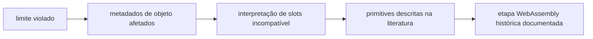

# Auditoria técnica de OOB-V8 (*CTF 2019)

## 1. Introdução

Este estudo examina uma falha histórica e deliberada no V8 do *CTF 2019. O foco é a propriedade de que o índice usado por uma operação interna deve permanecer dentro dos limites lógicos e físicos do array. O projeto separa evidência documental, análise estática e testes de runtime seguros.

## 2. Contexto histórico

O [Browser Dojo](https://github.com/jackfromeast/browser-dojo/tree/main/v8/2019-star-ctf-oob-v8) identifica o desafio como V8 7.5.0 modificado. O [relato de Faraz](https://faraz.faith/2019-12-13-starctf-oob-v8-indepth/) usa o commit `6dc88c191f5ecc5389dc26efa3ca0907faef3598` e aplica `oob.diff`. O script de build público registra esse commit em `build.sh:8`; o cabeçalho desse commit declara 7.5.0.0 em `v8-version.h:11-14`. São fontes independentes de nome e versão do binário; não se extraiu o commit do ELF.

## 3. Arquitetura do V8

`JSArray` deriva de `JSObject`, que guarda um ponteiro `elements` para o armazenamento (`js-objects.h:767-774`). `JSArray` tem `length` lógico (`js-array.h:24-27`). O backing store rápido é `FixedArrayBase`, com comprimento próprio (`fixed-array.h:70-80`); para slots double usa `FixedDoubleArray`, com tamanho `header + length * kDoubleSize` (`fixed-array.h:226-257`). Em modo rápido a relação documentada é `JSArray.length <= elements.length()` (`js-array.h:19-23`). O `Map` é um objeto de metadados que informa tipo, layout e Elements Kind (`map.h:92-103,260-272`).

```mermaid
flowchart LR
  JS[JSArray\nMap | elements | length lógico] --> BS[FixedDoubleArray\nMap | length do backing | doubles]
  JS --> M[Map\ninstance type | Elements Kind]
  M --> R[rotina interpreta slots]
```

## 4. Ambiente experimental

O inventário inicial encontrou somente o writeup de seminário na raiz; os demais artefatos foram baixados da referência pública para `evidence/origins/`, sem alterar o original local. O tarball possui 131 entradas e inclui Chrome e o diff. O binário `d8` baixado é ELF x86-64; foi executado com seus blobs correspondentes. O sistema atual é x86_64, mas isso não determina por si a arquitetura do binário. Métodos, hashes, comandos e logs estão em [INVENTORY](../environment/INVENTORY.md) e [RESULTS](../regression-tests/RESULTS.md).

## 5. Análise da vulnerabilidade

O diff modifica quatro arquivos: `src/bootstrapper.cc` instala `oob`, `builtins-definitions.h` registra o builtin, `compiler/typer.cc` atribui tipo e `src/builtins/builtins-array.cc` implementa `ArrayOob` (`oob.diff:1-65`). O trecho decisivo é:

```cpp
uint32_t length = static_cast<uint32_t>(array->length()->Number());
// leitura: elements.get_scalar(length)
// escrita: elements.set(length, value->Number())
```

Em um array lógico com `length = 3`, os elementos existentes são índices 0, 1 e 2. A operação usa 3. Se `elements.length() == 3`, é também o primeiro índice fora da alocação. Se o backing tiver capacidade maior, o acesso físico pode ficar dentro dele, mas ainda viola a faixa lógica. A guarda `len > 2` do diff conta argumentos do builtin e não valida o índice (`oob.diff:22-41`).

| Condição | Faixa autorizada | Índice usado | Resultado da auditoria |
| --- | --- | --- | --- |
| Comprimento lógico `n` | `0..n-1` | `n` | Fora da faixa lógica. |
| Capacidade física `c = n` | `0..c-1` | `n` | Fora da faixa física. |
| Capacidade física `c > n` | `0..c-1` | `n` | Fisicamente dentro, logicamente fora. |

## 6. Root cause

Há três falhas independentes no builtin adicionado: uso de `length` como índice, cast de `receiver` para `JSArray` sem guarda explícita e cast de `elements` para `FixedDoubleArray` sem verificar Elements Kind. `get_scalar` possui `DCHECK` de limite (`fixed-array-inl.h:318-324`), que não constitui defesa em build release; `set` calcula o offset de escrita sem checar índice (`fixed-array-inl.h:343-352`). A ausência dessas guardas aparece no [relatório JSON](../evidence/logs/invariant-report.json). A análise textual prova a ausência nos trechos examinados, não o alcance físico exato em uma execução específica.

## 7. Estruturas internas de memória

`HeapObject` contém campo `map` tagged no cabeçalho (`heap-object.h:178-187`). `JSObject` contém campo `elements` (`js-objects.h:767-774`), e `JSArray` acrescenta `length` (`js-array.h:98-103`). `FixedArray` usa slots tagged (`fixed-array.h:114-138,178`), enquanto `FixedDoubleArray` usa slots numéricos de largura double (`fixed-array.h:226-257`). O V8 histórico distingue valores pequenos imediatos (Smi) de referências a objetos por representação tagged; os números double em `FixedDoubleArray` são armazenados como valores não tagged. O [relato de Faraz](https://faraz.faith/2019-12-13-starctf-oob-v8-indepth/) documenta essa distinção para o artefato histórico. Layout e tagging dependem da versão e do build; endereços e deslocamentos da literatura não foram tratados como constantes gerais.

## 8. Maps e Elements Kind

`elements-kind.h:29-45` declara famílias Smi, objeto, double e dicionário, cada uma com variantes packed ou holey quando aplicável. `map.h:265-272` reserva bits para Elements Kind. O Map determina qual caminho interpreta o backing store. Se a interpretação do Map divergir do formato real dos slots, surge confusão de tipos. O teste seguro `%HaveSameMap` observou que dois arrays double continuaram com o mesmo Map antes e depois de leituras e escrita em índice válido ([log](../evidence/logs/d8-map-capacity.log)); isso não mede o efeito de `oob()`.

## 9. Análise documental do exploit público

O arquivo original [solve.js](../evidence/origins/solve.js) foi lido estaticamente e nunca executado. Ele organiza a cadeia em: representação de bits com `ArrayBuffer`/typed arrays (`:4-27`), leitura de metadados e construção das primitives chamadas `addrof` e `fakeobj` (`:34-79`), abstrações de leitura/escrita (`:127-180`) e uma etapa WebAssembly (`:198-226`). Em termos conceituais, `addrof` revela uma referência como dados, `fakeobj` faz dados serem interpretados como referência e as abstrações posteriores ampliam o alcance de leitura/escrita. A viabilidade depende de confusão entre Map e formato de elementos, da disposição do heap e do V8 histórico. O relato público usa um layout particular observado em seu ambiente; não se reproduziu esse layout aqui.



## 10. Internals do WebAssembly

WebAssembly no V8 cria módulo, instância e função exportada, representados por objetos do motor e código compilado. `solve.js:198-201` usa `WebAssembly.Module`, `WebAssembly.Instance` e a exportação `main`; as linhas seguintes assumem detalhes internos do V8 7.5 e uma região de código do ambiente do CTF. Esta etapa é relatada apenas como arquitetura documental. O projeto não testa offsets, permissões de memória, endereços ou qualquer execução arbitrária. `ArrayBuffer` e `DataView` têm papéis distintos: o primeiro oferece armazenamento de bytes; o segundo faz leituras/escritas tipadas nesse armazenamento segundo a semântica JavaScript. A solução pública os relaciona à representação de dados (`solve.js:154-156`), mas os testes deste projeto não usam isso para modificar memória do motor.

## 11. Correção

Remover o builtin introduzido pelo desafio elimina a nova superfície. Para uma API interna que precise acessar elementos, o chamador deve verificar o tipo do receiver, Elements Kind, índice inteiro não negativo, `index < JSArray.length` e `index < elements.length()`. A [proposta conservadora](../source-analysis/corrected_proposal.cc) recusa a operação histórica no índice `length`; a [proposta alternativa](../source-analysis/alternative_proposal.cc) ilustra uma API de índice explícito e dois limites. Nenhuma foi compilada ou apresentada como patch oficial. Os `PASS_STATIC` do analisador significam só que as guardas aparecem antes dos acessos em texto.

## 12. Testes de regressão

`safe_arrays.js` executa 26 asserções em `d8` e Node sobre índice válido, primeiro inválido, negativo, vazio, Smi, double, objeto e array com lacuna. `map_and_capacity.js` usa `%HaveSameMap` e valida que comprimento lógico e Map observável permanecem estáveis após operações seguras. Quatro testes Python exercitam a detecção do analisador, inclusive mutação de guarda ausente para presente. Outros quatro exercitam um [modelo controlado](../regression-tests/boundary_model.py) com `length == capacity`, capacidade excedente, índices inválidos e Elements Kind; o modelo não reproduz o heap V8. Logs completos e limitações constam em [RESULTS](../regression-tests/RESULTS.md). Esses testes não chamam `oob()`.

## 13. Contribuição própria

O [V8 Invariant Analyzer](../contribution/README.md) identifica versão no cabeçalho, commit no script de build, arquitetura no ELF, estruturas de arrays, relação entre comprimentos, Elements Kind e Map no fonte, além dos caminhos alterados pelo diff. Para cada propriedade registra fonte, método, esperado, observado, evidência e conclusão em JSON. Entradas são identificadas por SHA-256. Os resultados `UNKNOWN` preservam incerteza quando não há evidência. A detecção é textual e requer revisão humana.

## 14. Resultados experimentais

| Situação | Guardas de backing, receiver, kind | Execução V8 | Interpretação |
| --- | --- | --- | --- |
| Código vulnerável no diff | `FAIL` nas quatro verificações | `d8` executou apenas testes normais | Ausência textual de guardas; runtime vulnerável não provocado. |
| Correção proposta | `PASS_STATIC` nas quatro | Não compilada | Guarda textual do backing e recusa do índice lógico `length`. |
| Validação alternativa | `PASS_STATIC` nas quatro | Não compilada | Guarda textual de índice contra comprimento lógico e backing. |

Os dez pontos estruturais do código-fonte foram encontrados. O analisador distingue as variantes textuais, mas não demonstrou que testes de runtime detectariam regressão na implementação nativa corrigida. O estado de builds corrigidos é **não avaliado**.

## 15. Limitações

O checkout inicial não tinha os artefatos alegados no enunciado; foram obtidos de fontes públicas. Não foi construído V8 7.5 localmente, nem executado `oob()` para evitar acesso indevido à memória. O binário `d8` baixado não teve a correspondência com o commit atestada por assinatura; essa associação vem do repositório público. A capacidade do backing store não foi medida diretamente em runtime. `PASS_STATIC` não prova que uma guarda domina todos os caminhos ou que o código compila; os arquivos C++ de propostas são pseudocódigo comparativo. O estudo não generaliza offsets, proteção de páginas ou primitives do CTF para V8 atual.

## 16. Conclusão

O defeito central é verificável no diff: o builtin usa `JSArray.length` como índice de acesso e não valida o armazenamento nem o tipo antes dos casts. O código-fonte histórico mostra por que `length` lógico e comprimento do backing precisam ser distinguidos. Os testes seguros documentam o comportamento normal do `d8` histórico, enquanto a ferramenta independente registra a ausência e a presença textual das guardas com evidência e limites explícitos.

## 17. Referências

1. [Browser Dojo, material do desafio](https://github.com/jackfromeast/browser-dojo/tree/main/v8/2019-star-ctf-oob-v8), incluindo `build/oob.diff`, `build/build.sh` e `solution/solve.js`.
2. [Faraz, *Exploiting v8: StarCTF 2019 oob-v8*](https://faraz.faith/2019-12-13-starctf-oob-v8-indepth/), 2019.
3. [V8, commit histórico `6dc88c1`](https://github.com/v8/v8/tree/6dc88c191f5ecc5389dc26efa3ca0907faef3598), arquivos citados por caminho e linha acima.
4. [V8, Elements Kinds](https://v8.dev/blog/elements-kinds), contexto conceitual; detalhes deste estudo usam o commit histórico.
